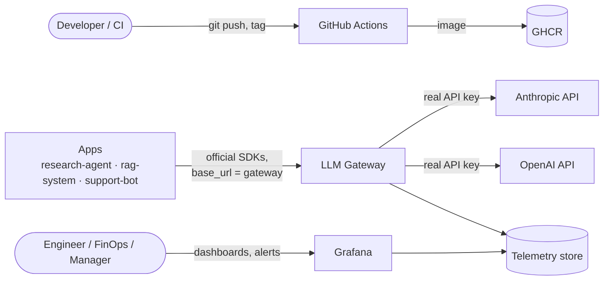
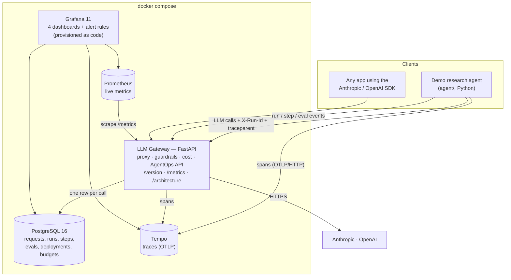
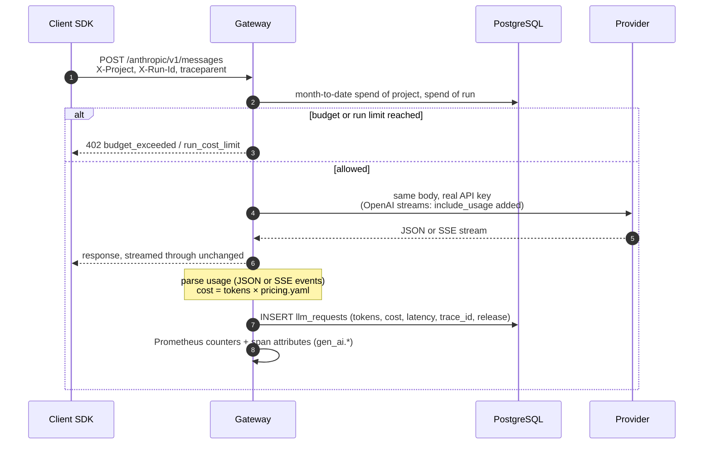
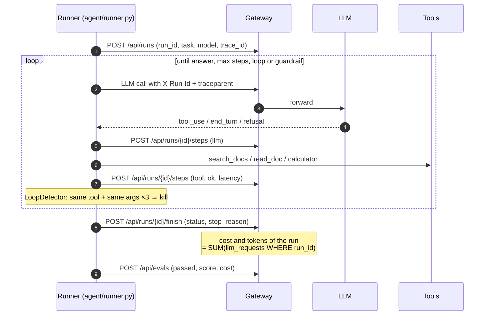
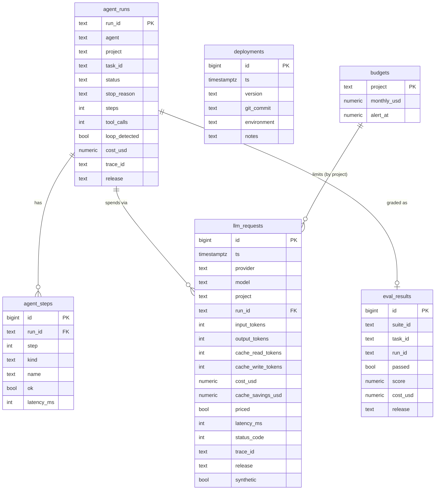
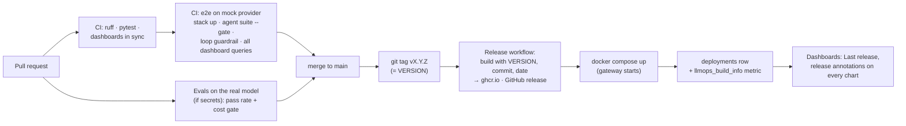

# Architecture

LLMOps Platform puts one component, the **LLM gateway**, between applications
and the model providers. Every call goes through it, so a single place can
answer three questions:

| Discipline | Question | Where the answer lives |
|---|---|---|
| **FinOps** | How many tokens do we spend, on what, and is it worth it? | `llm_requests`, budgets, FinOps dashboard |
| **AgentOps** | Do our agents work, and how do they fail? | `agent_runs`, `agent_steps`, `eval_results`, traces, AgentOps dashboard |
| **DevOps** | What is deployed, did the last release change anything, is it healthy? | `deployments`, `/metrics`, CI/CD, Platform dashboard |

Other docs: [ADRs](adr/README.md) · [Runbook](runbook.md)

## 1. System context



Applications keep using the official SDKs. Adopting the platform is a
configuration change, not a code change:

```python
Anthropic(base_url="http://gateway:8080/anthropic")      # or ANTHROPIC_BASE_URL
OpenAI(base_url="http://gateway:8080/openai/v1")         # or OPENAI_BASE_URL
# Attribution without headers: put the project in the URL
Anthropic(base_url="http://gateway:8080/p/rag-system/anthropic")
```

## 2. Containers



| Container | Responsibility | Why this technology |
|---|---|---|
| Gateway | Pass-through proxy, usage parsing, pricing, budgets, run kill switch, AgentOps API, build info | FastAPI + httpx async: streaming pass-through with little code; built-in OpenTelemetry ([ADR 0001](adr/0001-own-gateway.md)) |
| PostgreSQL | Durable per-request ledger, the FinOps source of truth | SQL is the natural language for cost questions; Grafana queries it directly ([ADR 0002](adr/0002-postgres-and-prometheus.md)) |
| Prometheus | Live throughput, latency histograms, build info | Standard for operational metrics and alerting on rates |
| Tempo | Distributed traces of agent runs | OTLP native, no extra database, links from Grafana |
| Grafana | Dashboards and alerts | Everything provisioned from the repo ([ADR 0003](adr/0003-dashboards-as-code.md)) |

## 3. Gateway request path



Design points:

- **Transparent**: the body is forwarded byte for byte (except
  `stream_options.include_usage` for OpenAI streams), so new API features
  work without gateway changes. Unknown models are proxied but flagged
  `priced = false` and alerted on.
- **Usage normalization** ([gateway/usage.py](../gateway/usage.py)):
  `input_tokens` always means *uncached* input. Anthropic already reports it
  that way; OpenAI's `prompt_tokens` include cached tokens, which are
  subtracted.
- **402 instead of 429** for guardrails: the SDKs retry 429 automatically;
  a budget refusal must not be retried.
- **Recording never breaks a request**: failures to write telemetry are
  logged, the client still gets its response.

## 4. Agent run (AgentOps)



One trace covers the whole run, across processes:

```
research-agent  invoke_agent research-agent
research-agent    anthropic.messages.create        (SDK span)
llm-gateway         POST /anthropic/{path}         (FastAPI server span)
llm-gateway           chat claude-opus-5-5         (tokens, cost)
research-agent    execute_tool search_docs
...
```

Guardrails, in order of who enforces them:

| Guardrail | Enforced by | Result |
|---|---|---|
| Max steps (`AGENT_MAX_STEPS`) | agent | `failed / max_steps` |
| Tool loop (`AGENT_LOOP_REPEAT_LIMIT`) | agent | `killed / loop_detected` |
| Cost per run (`MAX_RUN_COST_USD`) | **gateway** | `killed / run_cost_limit` |
| Monthly project budget (`config/budgets.yaml`) | **gateway** | `killed / budget_exceeded` |
| Model refusal | model; fallback model via `fallbacks: "default"` | `failed / refusal` |

Cost limits live in the gateway on purpose: a buggy agent can't bypass them.

**Quality** is measured by a deterministic eval suite
([agent/tasks.json](../agent/tasks.json), [agent/evals.py](../agent/evals.py)):
numeric and keyword checks, no LLM judge, so grading is free, reproducible and
safe to gate CI on ([ADR 0004](adr/0004-deterministic-evals-and-ci-gate.md)).

## 5. Data model



Every table carries `release`, or is joined to `deployments` by time, so any
metric can be split by version. Every table carries `synthetic`, so demo data
and real traffic never mix in budgets or alerts.

## 6. Release and deployment flow (DevOps)



The gateway records itself in `deployments` when it starts with a
version/commit different from the last one. Every time-series panel shows
releases as annotations, which is what makes the FinOps and AgentOps charts
explainable: in the demo data, the cost per run drops at *0.3.0 prompt
caching* and runs get killed between *0.2.1* and its hotfix *0.2.2*.

CI never needs API keys: the e2e job runs the real gateway and the real agent
against [a mock provider](../tools/mock_llm.py) that speaks both APIs,
streaming included ([ADR 0005](adr/0005-mock-provider-for-ci.md)).

## 7. Dashboards

| Dashboard | Key panels |
|---|---|
| **Overview** (home) | Last release + when, spend month to date, tokens today, agent success rate, eval pass rate, spend and tokens per day, budget used, release history |
| **FinOps** | Spend, month-end forecast, prompt-cache savings, cost per successful run, unpriced requests; cost per day by model, spend by project / model, cache hit ratio, most expensive runs |
| **AgentOps** | Runs, success rate, killed runs, steps, tool error rate, eval pass rate; outcomes per day, stop reasons, tool reliability, recent runs with trace links, Tempo trace search |
| **Platform** | Running version and commit (from `/metrics`), uptime, deployment frequency, error rate, p95 latency, live RPS and latency histograms, guardrail rejections, release history |

All dashboards share two variables: **Data** (`all` / `real` / `demo`) and
**Project**.

## 8. Configuration as code

| File | Owns |
|---|---|
| `config/pricing.yaml` | Price per model (per 1M tokens: input, output, cache read, cache write) |
| `config/budgets.yaml` | Monthly budget and alert threshold per project |
| `evals/baseline.json` | Minimum pass rate and reference cost per task, per model |
| `tools/build_dashboards.py` | The four Grafana dashboards (JSON is generated) |
| `observability/grafana/provisioning/` | Data sources, dashboard provider, alert rules |
| `VERSION` | Release version; the release tag must match it |

## 9. Production notes

Deliberately out of scope for a laptop setup, and what would change:

- **Collector**: put an OpenTelemetry Collector between services and Tempo
  (batching, sampling, fan-out); Tempo on object storage.
- **Write path**: the gateway writes one row per call synchronously. At
  high volume, batch inserts through a queue, and partition `llm_requests`
  by month.
- **Secrets**: provider keys from a secret manager, per-project virtual keys
  instead of the `/p/<project>` URL.
- **HA**: several gateway replicas behind a load balancer; budget checks are
  already stateless (they read Postgres).
- **Alert routing**: contact points (Slack, PagerDuty) for the provisioned rules.
